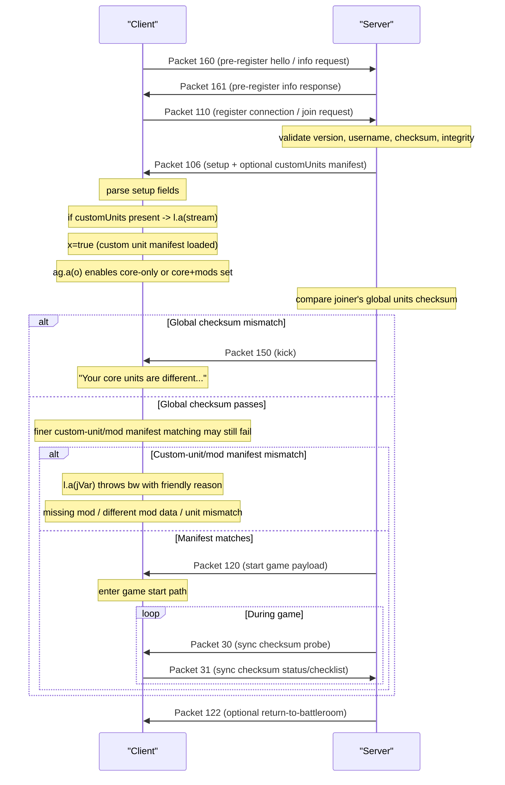

# Rusted Warfare Multiplayer Handshake Timeline

Scope:

- setup / custom-unit compatibility / checksum / start-game timeline
- grounded only in currently recovered packet send/receive code

Primary references:

- [ae.java](../../jadx_out/sources/com/corrodinggames/rts/gameFramework/j/ae.java)
- [NETWORK_PACKET_MAP.md](NETWORK_PACKET_MAP.md)
- [NETWORK_CUSTOM_SYNC.md](NETWORK_CUSTOM_SYNC.md)

## 1. High-level timeline

## 2. Detailed stage notes

### Stage A: Server info request

Packet:

- `160`

What we know:

- client send side is visible
- server receive side parses it before sending packet `161`
- payload includes:
  - package string
  - protocol/versioned handshake ints
  - optional query string
  - optional misc strings

References:

- [ae.java](../../jadx_out/sources/com/corrodinggames/rts/gameFramework/j/ae.java#L2244)
- [ae.java](../../jadx_out/sources/com/corrodinggames/rts/gameFramework/j/ae.java#L6215)

Interpretation:

- `160` is the actual pre-register hello / capability request

Legacy/auxiliary note:

- packet `105` still exists and is received as `PACKET_GET_SERVER_INFO`
- but the visible main modern join flow is built around `160/161/110`

## 3. Stage B: Pre-register response

Packet:

- `161`

Server send side:

- built in direct response to packet `160`
- includes at least:
  - package string
  - prereg packet version
  - server version/app code
  - platform/build data
  - server version string
  - `networkServerId`
  - integrity challenge values

References:

- [ae.java](../../jadx_out/sources/com/corrodinggames/rts/gameFramework/j/ae.java#L6439)

Client receive side:

- stores fields into `U`, `V`, `W`, `X`
- then immediately calls `f(connection)` which sends packet `110`

References:

- [ae.java](../../jadx_out/sources/com/corrodinggames/rts/gameFramework/j/ae.java#L6468)
- [ae.java](../../jadx_out/sources/com/corrodinggames/rts/gameFramework/j/ae.java#L6486)

## 4. Stage C: Register connection / join request

Packet:

- `110`

Client send side:

- `sendRegisterConnection...`
- includes:
  - package string
  - join packet version `5`
  - client version/app code
  - platform/build code
  - username
  - password hash if set
  - version string / install info
  - device/integrity string `S()`
  - `getAllUnitsChecksum()` via `game.r()`
  - integrity response derived from `V`
  - integrity response derived from `W`

Reference:

- [ae.java](../../jadx_out/sources/com/corrodinggames/rts/gameFramework/j/ae.java#L2415)

Server receive side:

- validates:
  - username length
  - bans
  - game version
  - core unit checksum
  - integrity response
  - room lock / game started / password
- creates or reconnects player

References:

- [ae.java](../../jadx_out/sources/com/corrodinggames/rts/gameFramework/j/ae.java#L6808)
- [ae.java](../../jadx_out/sources/com/corrodinggames/rts/gameFramework/j/ae.java#L6940)

## 5. Stage D: Setup packet with custom-unit manifest

Packet:

- `106`

Server send side:

- writes setup fields
- if not chat-only, appends a boolean + `custom.l.a(bgVar2)` manifest
- sends packet `106`

References:

- [ae.java](../../jadx_out/sources/com/corrodinggames/rts/gameFramework/j/ae.java#L1652)
- [ae.java](../../jadx_out/sources/com/corrodinggames/rts/gameFramework/j/ae.java#L1699)

Client receive side:

- parses versioned setup fields
- for packet version `>= 3`, if a boolean is true:
  - calls `custom.l.a(stream)`
  - sets `x = true`

Fallback references:

- [ae.java](../../jadx_out/sources/com/corrodinggames/rts/gameFramework/j/ae.java#L5942)
- [ae.java](../../jadx_out/sources/com/corrodinggames/rts/gameFramework/j/ae.java#L6000)

Interpretation:

- packet `106` is the moment where the client learns the server's custom-unit compatibility manifest

## 6. Stage E: Enable active custom-unit set

After setup processing, the client/server path calls:

- `ag.a(o)`

and logs:

- `enableAllCustomUnitsPossible mods:<bool>`

Fallback reference:

- [ae.java](../../jadx_out/sources/com/corrodinggames/rts/gameFramework/j/ae.java#L6592)

`ag.a(boolean)`:

- selects active unit definition set via `c(z)`
- clears pending network list
- swaps `l.d`
- rebuilds custom-unit registry

Reference:

- [ag.java](../../jadx_ag_fallback/ag.java#L436)

Interpretation:

- this is where the runtime chooses whether enabled modded custom units participate in the active registry for the session

## 7. Stage F: Coarse checksum gate

Before or during join approval, the server compares the client unit checksum against `game.r()`.

If it differs:

- client gets kicked with:
  - `"Your core units are different to the server's core units. Game can not be synchronized"`

Fallback reference:

- [ae.java](../../jadx_out/sources/com/corrodinggames/rts/gameFramework/j/ae.java#L6982)

Interpretation:

- this is the fast reject before finer mod/unit diagnostics

## 8. Stage G: Fine custom-unit/mod compatibility

When a `customUnits` manifest is parsed:

- `l.a(jVar)` compares remote unit records against local `l.c`
- a matching remote set is staged into `l.e`
- or a `bw` exception is raised with a nicer reason

Friendly reasons include:

- missing mod(s)
- different mod data
- required unit not found
- found unit but checksum mismatch vs server copy

References:

- [l.java](../../jadx_out/sources/a/a/l.java#L960)
- [l.java](../../jadx_out/sources/a/a/l.java#L899)

Interpretation:

- even if the global checksum layer passes, the session can still reject on detailed custom-unit incompatibility

## 9. Stage H: Start-game payload

Packet:

- `120`

Server send side:

- creates a payload with:
  - mode enum
  - map/save/custom-map payload
  - extra string marker/path
- wraps in packet `120`

Reference:

- [ae.java](../../jadx_out/sources/com/corrodinggames/rts/gameFramework/j/ae.java#L2688)

Client receive side:

- errors if received by server
- reads byte + mode enum
- may read embedded `j.g()` block
- stores into `aC` or `aD`
- reads `aB`
- calls `V()` to enter start flow

Reference:

- [NETWORK_PACKET_MAP.md](NETWORK_PACKET_MAP.md)

## 10. Stage I: Runtime sync maintenance

Packet pair:

- `30`
- `31`

Server side:

- periodically sends packet `30` containing frame/checksum checklist data

Reference:

- [ae.java](../../jadx_out/sources/com/corrodinggames/rts/gameFramework/j/ae.java#L1232)

Client side:

- on packet `30`, computes local values and returns packet `31`

Server side on `31`:

- compares checklist values
- marks client as matching or desynced
- may pause or resync depending on settings

References:

- [ae.java](../../jadx_out/sources/com/corrodinggames/rts/gameFramework/j/ae.java#L1367)
- [ae.java](../../jadx_out/sources/com/corrodinggames/rts/gameFramework/j/ae.java#L1431)

Interpretation:

- join-time compatibility does not replace runtime sync integrity checks

## 11. Return-to-battleroom flow

Packet:

- `122`

Server send side:

- generated after countdown/transition logic

Reference:

- [ae.java](../../jadx_out/sources/com/corrodinggames/rts/gameFramework/j/ae.java#L919)

Client receive side:

- flips local battleroom return flag and later performs the transition

Reference:

- [ae.java](../../jadx_out/sources/com/corrodinggames/rts/gameFramework/j/ae.java#L7349)

## 12. Save/replay reuse of the same format

Save/replay logic writes:

- `customUnitsBlock`

and on load:

- `l.a(jVar)`
- `ag.c()`

References:

- [aj.java](../../jadx_aj_fallback/aj.java#L300)
- [aj.java](../../jadx_aj_fallback/aj.java#L1028)

Interpretation:

- the custom-unit compatibility manifest format is reused across:
  - saves
  - replays
  - live multiplayer setup

## 13. Most reliable summary

The most grounded handshake path we currently have is:

1. client sends packet `160`
2. server replies with packet `161`
3. client sends packet `110`
4. server validates version / checksum / integrity / password / slot
5. server sends packet `106`
6. client loads `customUnits` manifest if present
7. client/server align active custom-unit set via `ag.a(o)`
8. if game starts, server sends packet `120`
9. during match, packets `30` and `31` maintain sync integrity

## 14. Remaining unknowns

Still worth recovering later:

- exact field map for packet `151`
- precise relationship between legacy packet `105` and the modern `160/161` path
- whether packet `106` can also be pushed proactively outside the normal join path
- precise role of packets `160+` in team/player/game-state updates relative to custom units

---
**相关**：[INDEX](../../INDEX.md) · 组内：`NETWORK_PACKET_MAP`/`HANDSHAKE_TIMELINE`/`JOIN_PACKET_FIELDS`/`START_GAME_PACKET`/`CUSTOM_MAP_BLOB`/`NETWORK_SYNC_SYSTEM`/`NETWORK_CUSTOM_SYNC`/`NETWORK_GAMEPLAY_FLOW` · 实现：`../../../relay_client.py` · `../../../phantom_cli.py` · `../../../tools/rw_crypto.py`
